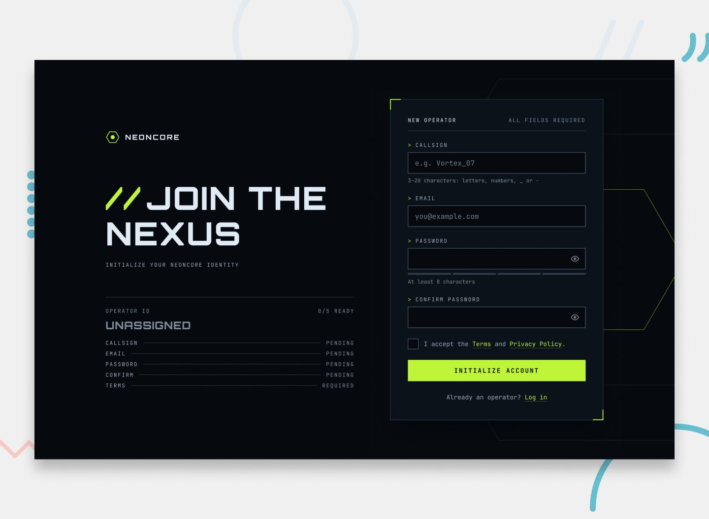

# NEONCORE Sign-up Form



A responsive, cyberpunk-inspired registration experience for NEONCORE, a competitive gaming network. The interface combines a focused sign-up flow with real-time validation, password guidance, operator status tracking, and a simulated account-provisioning success state.

## Features

- Responsive layouts for desktop, tablet, and mobile viewports
- Callsign validation:
  - 3–20 characters
  - Letters, numbers, underscores, and hyphens only
- Email format validation
- Password confirmation validation
- Password visibility toggles
- Live password-strength meter with Weak, Fair, Good, and Strong states
- Terms and Privacy Policy consent requirement
- Operator ID readout that reflects form progress
- Accessible inline validation and submission announcements
- Automatic focus on the first invalid field after submission
- Loading state while an account is being provisioned
- Success screen personalized with the submitted callsign
- Keyboard-friendly controls and visible focus states

## Tech Stack

- Semantic HTML5
- CSS3 with responsive media queries
- Vanilla JavaScript
- Local `@font-face` assets
- No frameworks, build tools, or external runtime dependencies

## Getting Started

This is a static front-end project, so no package installation is required.

### Run locally

1. Clone or download the project.
2. Open `index.html` in a browser.

For the most reliable local development experience, serve the directory with any static file server. For example:

```bash
python -m http.server
```

Then open `http://localhost:8000`.

## Project Structure

```text
.
├── index.html       # Page structure and accessible form markup
├── styles.css       # Theme, layout, responsive styles, and component states
├── script.js        # Validation, password strength, status updates, and submission flow
├── assets/
│   ├── fonts/       # Orbitron and JetBrains Mono font files
│   └── images/      # Logo, icons, and background artwork
├── design/          # Reference design states
├── preview.jpg      # Project preview image
└── style-guide.md   # Original design tokens and typography guidance
```

## Validation and Interaction Behavior

Fields are checked when they lose focus, then revalidated on each keystroke after they have been visited. Empty fields remain quiet until submission, which keeps the initial experience uncluttered.

The password meter updates as the password is typed:

- **Weak**: fewer than 8 characters or a low score
- **Fair**: basic length and one additional character category
- **Good**: multiple character categories
- **Strong**: full length and character-category coverage

Password strength is advisory. The required password rule is a minimum of eight characters.

On an invalid submission, all fields are checked, the number of fields needing attention is announced, and focus moves to the first invalid control. On a valid submission, password fields are hidden, inputs are locked, and the interface displays a short `Transmitting_` state before showing the success message.

## Accessibility

- Every form control has an associated label.
- Validation messages are connected with `aria-describedby`.
- Dynamic progress and submission messages use live regions.
- Invalid submissions move focus to the first invalid field.
- Password visibility controls expose their current action through `aria-label`.
- The interface can be completed using the keyboard.
- Focus styling is preserved for interactive controls.

## Design

The visual system is based on the supplied NEONCORE design references:

- Orbitron for display headings
- JetBrains Mono for interface copy
- Dark navy surfaces with lime accent states
- Sharp corners and technical readout styling
- Responsive breakpoints optimized for desktop and mobile layouts

## Browser Support

The project is intended for current versions of Chrome, Edge, Firefox, and Safari.

## Credits

- Design challenge: [Frontend Mentor](https://www.frontendmentor.io)
- Fonts: [Orbitron](https://fonts.google.com/specimen/Orbitron) and [JetBrains Mono](https://fonts.google.com/specimen/JetBrains+Mono)

